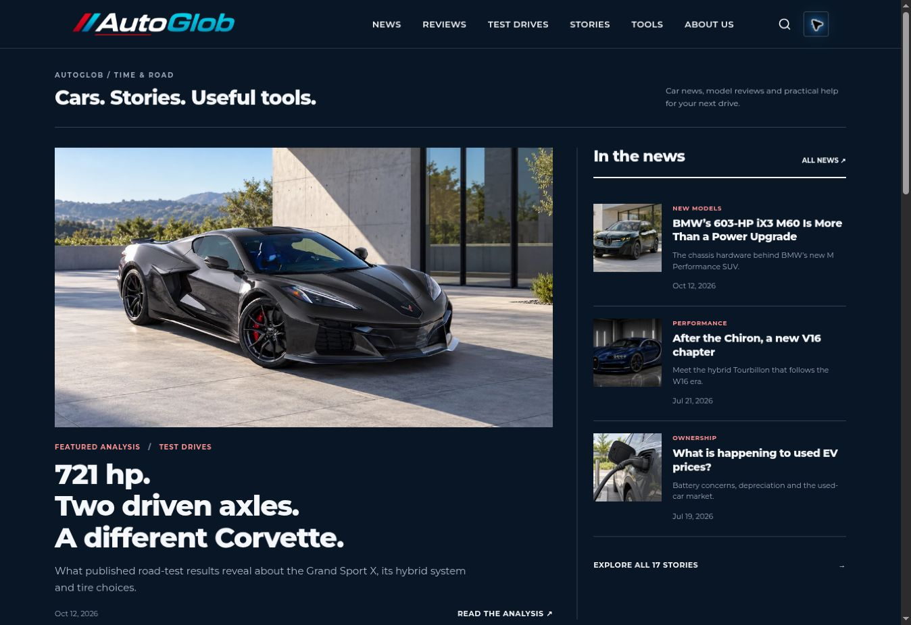

# Editorial update — October 12, 2026

Five original articles, three generated illustrations each. Vehicle identity, paint and trim are fixed within each article. Official imagery is used as the generation reference; generated scenes are explicitly labeled as illustrations.

AutoGlob has not personally driven the new vehicles. Manufacturer claims and independent measurements are separated. No fictional first-person testing is presented. The ownership guide uses hypothetical inputs, not current financial offers.

Research included Car and Driver, MotorTrend, Road & Track, Edmunds, Autoblog, Carscoops and Top Gear. Model facts were checked against BMW PressClub / BMW Classic, Volvo USA, Chevrolet / GM and Toyota USA. This is not a traffic ranking of those publications.

## BMW’s 603-HP iX3 M60 Is More Than a Power Upgrade

- BMW USA: iX3 M60 announcement: https://www.press.bmwgroup.com/usa/article/detail/T0461525EN_US/the-new-bmw-ix3-m60-xdrive:-dynamically-outstanding-m-performance-model-added-to-the-line-up-for-the-fully-electric-suv
- MotorTrend: 2027 iX3 M60 first look: https://www.motortrend.com/news/first-look-2027-bmw-ix3-m60-xdrive

## Volvo EX60 P10: Beyond the 400-Mile Headline

- Volvo USA: EX60 specifications and timing: https://www.volvocars.com/us/cars/ex60-electric/
- MotorTrend: EX60 instrumented first test: https://www.motortrend.com/reviews/first-test-2027-volvo-ex60
- Road & Track: EX60 driving impressions: https://www.roadandtrack.com/reviews/a71345937/volvo-ex60-review/
- Autoblog: 2027 EX60 overview: https://www.autoblog.com/cars/volvo/ex60/2027

## Corvette Grand Sport X: What 721 HP and AWD Change

- Chevrolet: Grand Sport X product specifications: https://www.chevrolet.com/performance/corvette/grand-sport-x
- GM: Grand Sport and LS6 engineering announcement: https://news.gm.com/home.detail.html/Pages/news/us/en/2026/mar/0326-Chevrolet-Grand-Sport-returns-6-7-liter-535-horsepower-V8.html
- Car and Driver: Grand Sport X instrumented test: https://www.caranddriver.com/reviews/a73591474/2027-chevrolet-corvette-grand-sport-x-drive/

## The BMW 528i E39 and the Value of an Ordinary 5 Series

- BMW Group Classic: 528i E39 archive: https://www.bmwgroup-classic.com/en/models/bmw-classics/product-description-page.ad-642-1.bmw-528i-e39.html
- BMW USA: history of the 5 Series: https://www.press.bmwgroup.com/usa/article/detail/T0022190EN_US/the-history-of-the-bmw-5-series
- BMW Group Classic: E39 generation archive: https://www.bmwgroup-classic.com/en/models/bmw-classics/product-description-page.ad-11-0.bmw-5-series-e39.html

## Gas, Hybrid or EV? Calculate What Your Car Really Costs

- U.S. DOE AFDC: vehicle cost comparison method: https://afdc.energy.gov/calc/
- CFPB: comparing auto loan offers: https://www.consumerfinance.gov/ask-cfpb/how-do-i-compare-auto-loan-offers-what-should-i-look-at-besides-the-monthly-payment-en-753/
- Toyota USA: vehicle image reference: https://www.toyota.com/camry/photo-gallery/all/section/gallery/slide/11/

## Validation

35 HTML pages checked for local links, anchors and valid JSON-LD. Sitemap contains 33 indexable pages. Five article image series are isolated, three images each. Ten theme logic cases passed, including blocked local storage. In the live browser, both palettes render; theme preference survives article navigation and reload. Search finds the BMW 528i article. All three Volvo images loaded and belong to the Volvo series.

