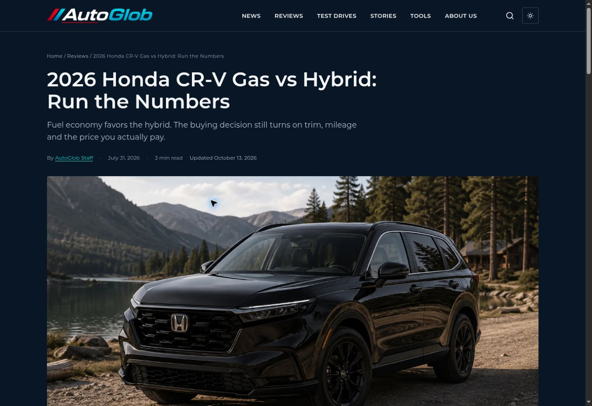
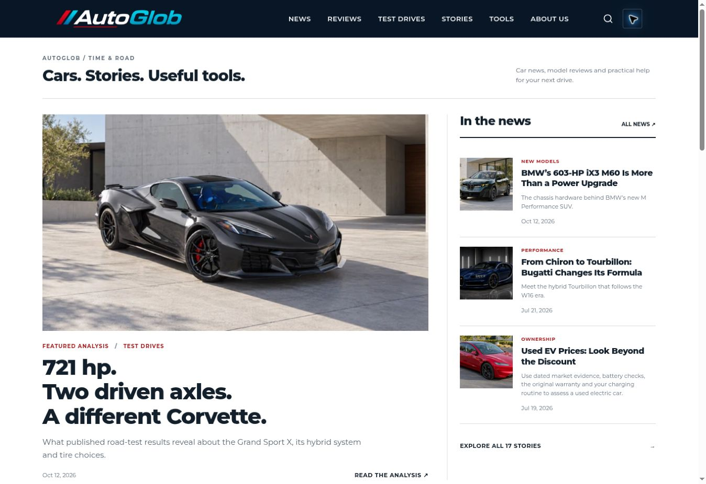

# Live verification — October 13, 2026

The SEO/content deployment and subsequent article-navigation polish both completed successfully. Verified public pages after publication, not only local source files.

- 53 live requests: 35 HTML pages, 15 new responsive/social assets, root robots, sitemap and one intentionally missing URL. No failed intended requests. Missing URL returned 404.
- All 17 article headlines matched the local implementation. Article image paths matched. All source blocks were closed by default and no numbered in-body source links remained.
- Root robots now declares the exact AutoGlob sitemap and preserves the TTN Finance sitemap. Its placeholder URL is gone.
- Browser: BMW G20 retains the gray-car hero and four illustrations; Honda retains the black-car hero and five illustrations; Bugatti retains its blue Chiron hero and four illustrations with corrected Chiron captions.
- Browser: Mercedes, Duesenberg, Group B Audi, 1963 Corvette cockpit and auction articles display the selected new assets. Group B's initial pending image completed loading on the next observation.
- Browser: source disclosure expands; search for G20 returns the updated article; Escape closes it and restores focus. Theme changes work and persist across navigation. Homepage verified in both light and dark appearances.
- Tools contains six calculators and VIN decoder, without an editorial article. Fuel UI: 300 miles, 30 US MPG and $3.50/gal returned $35. EV UI: 75 kWh, 20–80%, $0.16/kWh returned $8, 50 kWh drawn from wall and $13.33 for a full modeled charge.
- Unit checks cover all seven tools, mixed units, zero APR/free electricity, invalid inputs and VIN validation/rendering. VIN result uses an API fixture; no claim of a live vPIC response.

The final small text polish clarifies tool assumptions and removes an outdated W16-era phrase from the homepage card. It changes no formulas or imagery. Screenshots document the preserved Honda article and the light homepage layout during acceptance.

No Search Console, CrUX or AdSense account state was asserted or configured without credentials. No TTN Finance analytics code was inserted. All approved BMW G20/Honda/Bugatti image paths were explicitly compared against the baseline and remained identical.

